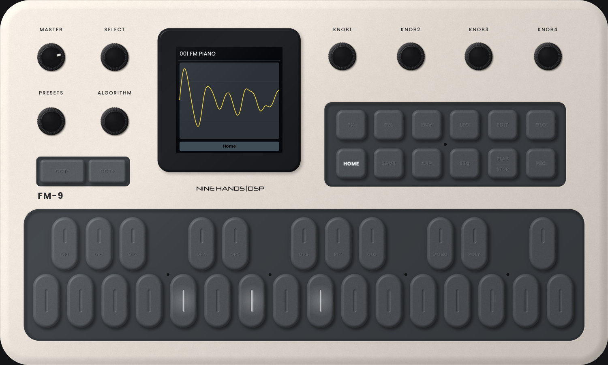
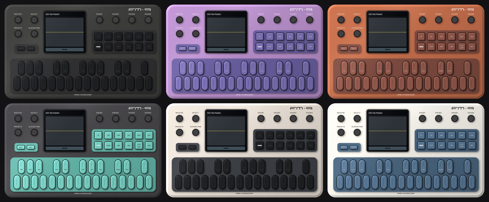

# FM-9

Synthétiseur FM 6 opérateurs au format VST3 (Windows et macOS), d'après le synthé de poche **M-VAVE FM-1**, à jouer depuis un clavier maître MIDI. Moteur DX7 (32 algorithmes, compatible SysEx DX7), 6 effets, arpégiateur et séquenceur 16 pas, façade fidèle à la FM-1.

  
  
   
  
   
  

## Ce que fait FM-9

- **Moteur FM 6 opérateurs** façon DX7 : 32 algorithmes, feedback, enveloppes 4 vitesses / 4 niveaux par opérateur, enveloppe de hauteur, LFO 6 formes d'onde, échelonnage clavier, sensibilité à la vélocité, mode ratio / fixe. Cœur **msfa** (licence Apache 2.0, voir `msfa/NOTICE.md`).
- **128 presets** (001-128, banques A à D de 32) ; banque A d'usine, 32 sons originaux. Import et export de **banques SysEx DX7** (.syx de 32 voix) et de voix seules ; les banques importées sont gardées pour tous les projets.
- **12 voix** de polyphonie, mode **MONO** avec glissando (Full Time ou Fingered), pitch bend haut / bas séparés (1 à 24 demi-tons), molette de modulation et aftertouch.
- **Enveloppe ADSR** d'amplitude optionnelle (touche ENV), comme sur la FM-1.
- **6 effets** dans une chaîne réordonnable (FX + SEL) : filtre (passe-bas / passe-bande / passe-haut), reverb (room / hall / plate), delay, distorsion, chorus, phaser.
- **Arpégiateur** : Up, Down, Inclusive, Exclusive, Random, Order, Repeat ; 1 à 4 octaves ; gate, swing, latch ; synchro au tempo de l'hôte.
- **Séquenceur 16 pas** : 16 patterns, chaîne de patterns, preset associé à chaque pattern, enregistrement pas à pas (notes longues, silences), swing, gate, transposition, synchro au transport de Reaper.
- **Façade de la FM-1** : 8 potards animés (MASTER + 7 encodeurs sans fin), écran couleur (oscilloscope, schéma de l'algorithme, grille des effets, pas du séquenceur), 12 touches de fonction, clavier 27 touches jouable à la souris avec ses LED.
- **MIDI** : clavier maître sur tous les canaux ou un seul, Program Change 0-127, réception de SysEx DX7, **MIDI Learn** par clic droit sur un potard (aucun CC assigné par défaut).
- **Skins** : les 6 coloris officiels de la FM-1 (Black, Purple, Orange, Black-Green, Cool Gray, White-Blue), couleurs de la coque, des pavés, des touches, des inscriptions et des LED réglables à la volée, skins enregistrables et échangeables (`.fm9skin`).
- **Arturia KeyStep 37** : profil optionnel (clic droit > MIDI > Controller), les 4 banques de potards de la KeyStep pilotent filtre, enveloppe, effets et LFO.
- **NKS** : export des presets pour Komplete Kontrol et Maschine (bibliothèque utilisateur), avec 6 pages de potards nommées.

## Firmwares de la FM-1

FM-9 fait tourner les **firmwares de la FM-1** à la place de son propre synthé : leur écran s'affiche dans la vitre, les touches, potards et LED de la façade sont les leurs, et le clavier maître les joue.

- **Paquets matériels (.fwsc)** : le fichier que l'on installe dans une vraie FM-1 tourne dans un **émulateur de la puce de la FM-1** (JieLi AC791N, deux cœurs pi32v2), repris du projet libre [fm1-emu](https://github.com/joakimeriksson/fm1-emu) de Joakim Eriksson (MIT, dossier `third_party/fm1-emu`, pont C dans `fm1hw/`). C'est le firmware de l'appareil, y compris celui d'origine de M-VAVE (non fourni : à télécharger chez M-VAVE).
- **Versions web (.wasm)** : les émulateurs web publiés par beaucoup de projets, lancés par **wasm3** (MIT, dossier `wasm3/`). **Hortator** (DEADACTIVE, GPL-3.0) est fourni.
- **Catalogue** (clic droit > Firmware > Catalog) : 300 firmwares recensés (listes [aroum/fm1-custom-fw](https://github.com/aroum/fm1-custom-fw) et fm1-emu), 215 compatibles, chacun marqué compatible ou non, avec son type (HARDWARE, WEB). Installation d'un clic ou de tous d'un coup, aperçu de l'écran au survol du nom. La liste (`catalog/firmwares.json`) est mise à jour sans nouvelle version du plugin (Refresh).
- **Install from GitHub...** et **Install from file** (.fwsc ou .wasm) ; les sauvegardes de chaque firmware sont gardées dans `Nine Hands DSP/FM-9/Firmwares`.

## Installation

Les boutons ci-dessus téléchargent toujours la dernière version.

- **Windows** : décompresser et copier `FM-9.vst3` dans `C:\Program Files\Common Files\VST3\`.
- **macOS** : décompresser et copier `FM-9.vst3` dans `~/Library/Audio/Plug-Ins/VST3/`.

Dans Reaper, FM-9 apparaît comme instrument : **VSTi: FM-9 (NINE HANDS | DSP)**.

## Compilation

JUCE 8.0.15 + CMake : `cmake -B build && cmake --build build --config Release`. Le visuel est généré par `tools/make_art.py` (façade 3000 x 1800 et potards en calques), les sons d'usine par `tools/gen_presets.py`. `tools/render` compile le plugin sous Linux pour les tests audio et les captures.

Anti-gel v2 : rendu logiciel sous Windows, caches reconstruits par le timer, chien de garde, aucun appel à l'hôte depuis le thread audio.

## Licence

FM-9 est distribué sous **GPL-3.0** (voir `LICENSE`), pour pouvoir accueillir les firmwares libres de la FM-1. Le cœur FM msfa reste sous Apache 2.0 (compatible, voir `msfa/NOTICE.md`) ; wasm3 sous licence MIT (`wasm3/LICENSE`) ; l'émulateur de la puce fm1-emu sous licence MIT (`third_party/fm1-emu/LICENSE`) ; Hortator (fourni) sous GPL-3.0 (`assets/firmware-licenses/`, source : https://github.com/DeadActive/hortator).

## Historique

- **1.3.4** : OCT- / OCT+ et transposition appliqués au clavier maître ; MIDI Learn sur tous les potards (SELECT, PRESETS, ALGORITHM, KNOB1-4 sur toutes les pages) ; configurations MIDI enregistrables (Save / Load MIDI map, configuration par défaut) ; écran interactif à la souris (liste et défilement des presets, réglages en glissant ou à la molette, double-clic = défaut).
- **1.3.3** : potards sans point indicateur.
- **1.3.2** : plaques grises sans biseau, logement noir autour de chaque touche et bouton, ombres portées identiques pour tous les éléments, occlusion autour de l'écran ; réglage Lights (couleur) et curseur Glow (0 à 100 %) des lumières des touches et des boutons, halo qui suit la forme de la LED et des lettres ; logo FM-9 centré entre KNOB3 et KNOB4.
- **1.3.1** : nouveau design de la façade d'après le mockup FM-9 (biseaux plats, ombres portées et occlusion, lumière à 45° en haut à gauche), nouveaux potards (centre fixe, couronne crantée qui tourne, point indicateur), logos FM-9 et NINE HANDS | DSP repositionnés.
- **1.3.0** : firmwares matériels de la FM-1 (.fwsc) dans un émulateur de la puce (fm1-emu), y compris le firmware d'origine ; catalogue de 300 firmwares (215 compatibles) avec aperçu de l'écran.
- **1.2.0** : skins (6 coloris de la FM-1), couleurs réglables à la volée et skins enregistrables ; profil Arturia KeyStep 37 ; export NKS (Komplete Kontrol / Maschine).
- **1.1.0** : hôte de firmwares de la FM-1 (WebAssembly) : installation depuis GitHub ou un fichier, Hortator fourni ; façade : touches noires, écran agrandi, touches OCT à la taille de l'original.
- **1.0.0** : première version.

---
NINE HANDS | DSP
